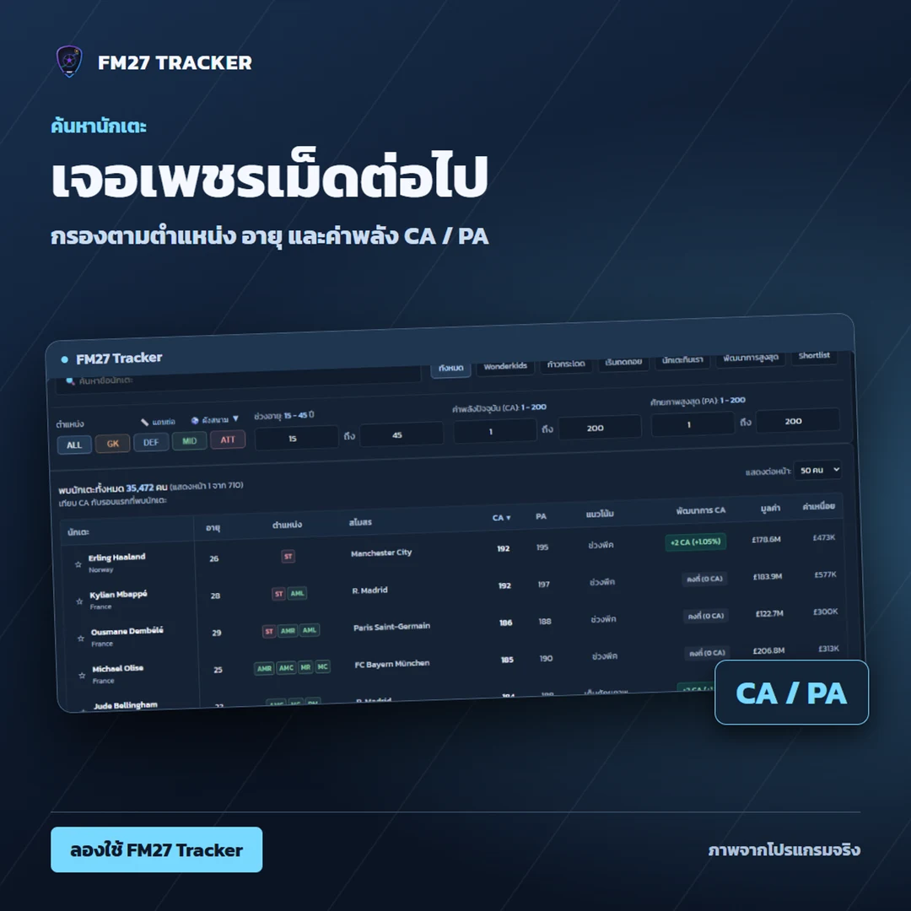
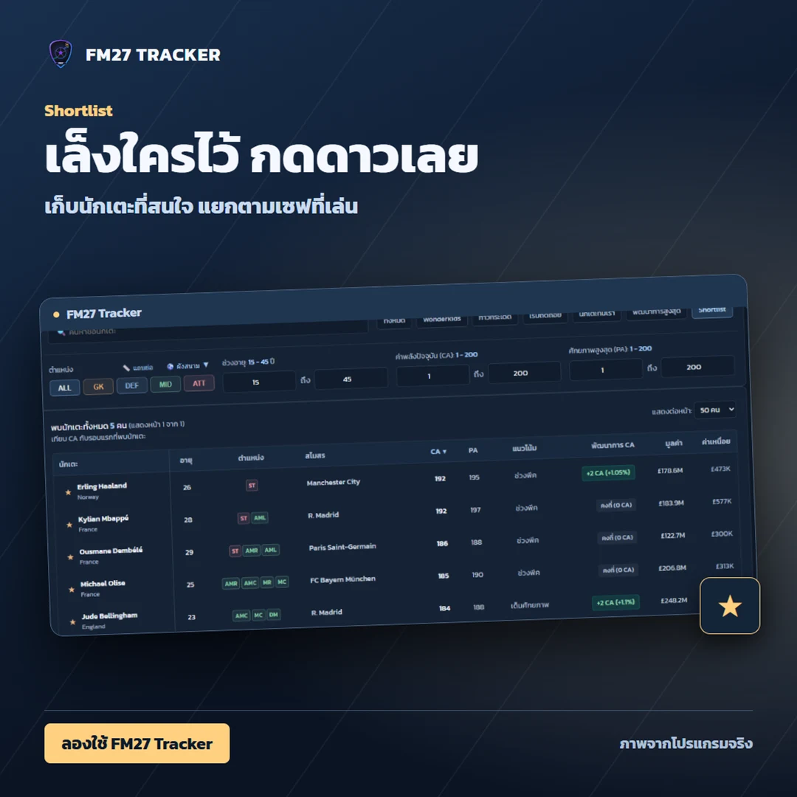
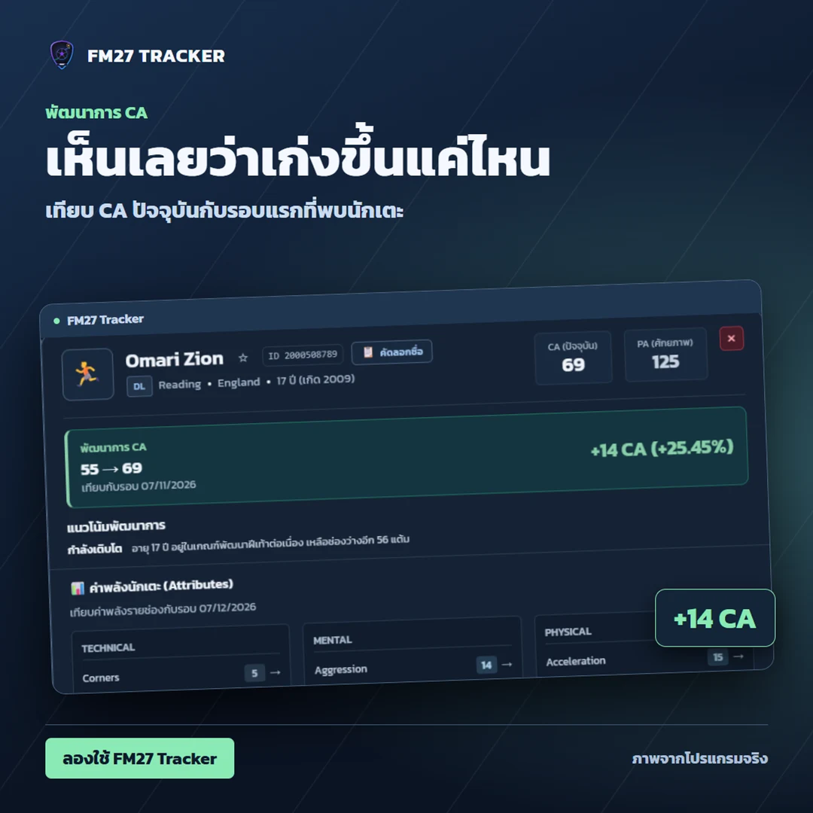
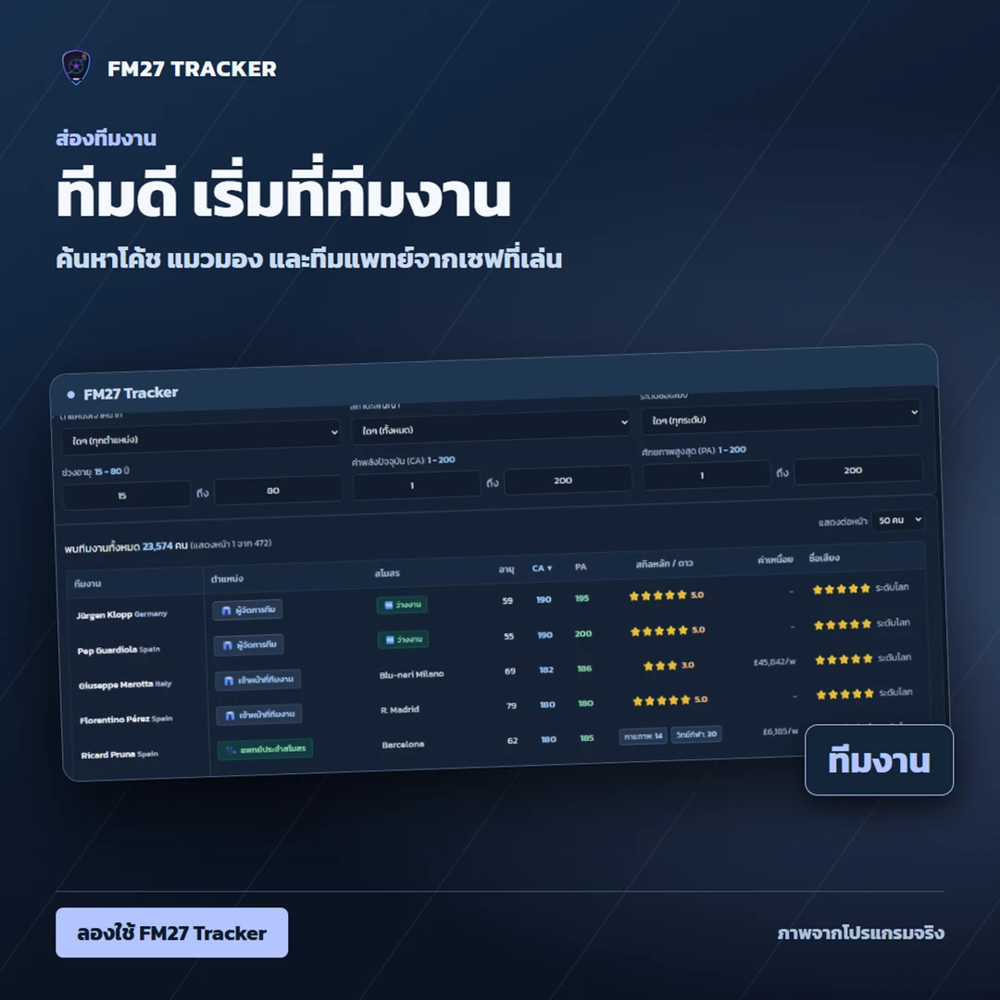

# ⚽ FM27 Thai Progression Tracker & Scout Tool

> **ระบบติดตามและค้นหานักเตะ Football Manager 27**
>
> อินเทอร์เฟซภาษาไทย พร้อมระบบประมวลผลและเก็บประวัติบนเครื่องผู้ใช้

---

## ดูฟีเจอร์จากหน้าจอจริง

<table>
<tr>
<td width="50%" valign="top"><br><strong>ค้นหานักเตะ</strong><br>กรองตามตำแหน่ง อายุ และค่าพลัง CA / PA เพื่อหานักเตะที่ตรงกับทีม</td>
<td width="50%" valign="top"><br><strong>Shortlist แยกตามเซฟ</strong><br>กดดาวเก็บนักเตะที่สนใจ แล้วเปิดดูรายชื่อของเซฟนั้นได้ทันที</td>
</tr>
<tr>
<td width="50%" valign="top"><br><strong>ติดตามพัฒนาการ CA</strong><br>ดูค่าพลังปัจจุบันและส่วนต่างจากรอบแรกที่ Tracker พบนักเตะคนนั้น</td>
<td width="50%" valign="top"><br><strong>ส่องทีมงาน</strong><br>ค้นหาโค้ช แมวมอง และทีมแพทย์ตามตำแหน่ง ทักษะ หรือสถานะว่างงาน</td>
</tr>
</table>

## 🌟 ฟีเจอร์หลัก (Key Features)

### 1. 📈 ระบบติดตามพัฒนาการนักเตะ (Player Progression Tracking)
* **First Seen Baseline** เปรียบเทียบ CA ปัจจุบันกับรอบแรกที่พบผู้เล่นในเซฟเดียวกัน แสดงส่วนต่างแบบ `+6 CA (+10.34%)`
* **เปรียบเทียบค่าพลังรายช่อง** โปรไฟล์แสดง **↑ เขียว**, **↓ แดง** หรือ **→ เทา** เมื่อมีข้อมูลเก่าให้เทียบ หากรอบแรกมีแค่ CA/PA ระบบใช้รอบแรกที่มีค่าพลังรายช่องและแสดงวันที่ฐานไว้ในโปรไฟล์ สแกนซ้ำวันเดิมจะอัปเดตรอบเดิม
* **Shortlist** กดดาวข้างชื่อนักเตะหรือในโปรไฟล์ รายการเก็บในเครื่องและแยกตามเซฟ
* **การเรียงตาราง** เริ่มจาก CA สูงสุด ส่วน Wonderkids เริ่มจาก PA สูงสุด
* **โปรไฟล์นักเตะ** แสดง ID จากตัวสแกน ค่าพลัง และสรุปพัฒนาการ CA ส่วนชื่อ, CA/PA และแนวโน้มจะตรึงอยู่ด้านบนขณะเลื่อนดูค่าพลังและสถิติแฝง
* **นักเตะที่เพิ่งพบ** แสดงป้าย **พบครั้งแรก** หรือ **เกิดใหม่** เมื่อข้อมูลสแกนระบุว่าเป็น newgen
* **พยากรณ์แนวโน้มการเติบโต (Trend Forecasting)**: คำนวณนิสัยแฝง (Personality), อายุ และเพดาน PA เพื่อจำแนกแนวโน้ม:
  * 🚀 **ก้าวกระโดด (Explosive)**: อายุน้อย เพดาน PA สูง นิสัยมุ่งมั่นสูง
  * 📈 **กำลังเติบโต (Developing)**: พัฒนาต่อเนื่องก่อนถึงจุดพีค
  * ⭐ **ช่วงพีค (Peak)**: วัยทองของอาชีพ รักษามาตรฐานได้ยอดเยี่ยม
  * ➖ **คงที่ (Stable)**: ค่าพลังไม่เปลี่ยนแปลง
  * 📉 **เริ่มถดถอย (Declining)**: วัยโรยราตามสภาพร่างกาย
* **ผังสนามเลือกตำแหน่ง (Tactical Pitch Selector)** เลือกจากผังสนามหรือแถบย่อ พร้อมตัวเลือก **Natural Position Only** ป้ายตำแหน่งใช้สีส้มสำหรับ GK น้ำเงินสำหรับ DEF เขียวสำหรับ MID และแดงสำหรับ ATT

---

### 2. 👔 ระบบส่องทีมงานเบื้องหลัง (Staff Scout)
* **ค้นหาทีมงานจากเซฟที่เปิดอยู่** ครอบคลุมโค้ช แมวมอง นักวิเคราะห์ ทีมแพทย์ และฝ่ายบริหาร จำนวนขึ้นอยู่กับผลสแกนของแต่ละเซฟ
* **ปุ่มลัดคัดกรองระดับโลก (Elite Preset Shortcuts)**:
  * 👁️ **แมวมองตาเพชร (JPA/JPP 18+)**: คัดเฉพาะแมวมองที่มีทักษะตัดสินใจศักยภาพและฝีเท้า 18 ขึ้นไป
  * 🏥 **หมอเทวดา (Physiotherapy 18+)**: คัดทีมนักกายภาพบำบัดรักษาอาการบาดเจ็บระดับท็อป
  * ⭐ **โค้ช 4.5–5 ดาว**: คัดเฉพาะโค้ชฝึกซ้อมที่มีคะแนนดาวฝึกซ้อมตั้งแต่ 4.5 ดาวขึ้นไป
  * 🌟 **HOYD ปั้นเยาวชน**: คัดหัวหน้าฝ่ายพัฒนาเยาวชนที่มีคุณสมบัติพาเด็กเกิดใหม่ระดับเทพเข้าสโมสร
  * 🆓 **สตาฟฟ์ว่างงาน (Unemployed)**: หาคนพร้อมเซ็นสัญญาฟรีทันที
* **คำนวณดาวฝึกซ้อม 6 หมวดตามสูตร FM**: เกมรุก, เกมรับ, แท็กติก, เทคนิค, ผู้รักษาประตู, ฟิตเนส
* **ปุ่มคัดลอกชื่อ (Copy Name)**: คลิกเดียวคัดลอกชื่อนักเตะหรือสตาฟฟ์ไปวางค้นหาใน FM27 ได้ทันที

---

### 3. 🎯 ระบบตรวจจับเซฟเกมและ RefCode
* **ตรวจจับเซฟจากผลสแกน** เมื่อสลับเซฟใน FM27 ให้กด **โหลดข้อมูลเกม (FM27)** อีกครั้ง Tracker ใช้ข้อมูลที่อ่านได้เพื่อระบุเซฟ บางกรณี เช่น เซฟว่างงานที่ระบุกุนซือไม่ได้ อาจยังจับคู่ประวัติไม่ได้
* **Save RefCode** หน้าจอแสดงรหัสแบบ **`#FM-55649B`** โดยใช้รหัสเดิมภายในสำหรับจับคู่ประวัติ เมื่อย้ายทีมแล้วระบบยังระบุอาชีพเดิมได้ ก็ใช้รหัสและประวัติเดิมต่อ
* **ประวัติแยกตามอาชีพ** ระบบใช้ Manager ID และข้อมูลเซฟที่อ่านได้เพื่อจับคู่ snapshot กับอาชีพของผู้เล่น

---

### 4. 👑 ดีไซน์เพื่อกุนซือ (Manager Header UI)
* แสดงสโมสร ผู้จัดการ รหัสเซฟ วันที่ในเกมแบบวัน/เดือน/ปี ค.ศ. และฐานเปรียบเทียบพัฒนาการ
* วันที่ประมาณจากระบบอาจไม่ตรงกับปฏิทิน FM27 ค่า CA/PA ปัจจุบันอ่านจากผลสแกน
* **เช็กอัปเดตในแอป** รุ่น Setup และ ZIP ตรวจเมื่อเปิดแอปและทุก 10 นาทีระหว่างเปิดค้างไว้ หรือกด **เช็กอัปเดต** ได้ทันที เมื่อพบรุ่นใหม่ให้กด **อัปเดตและเปิดใหม่** Tracker จะดาวน์โหลดและตรวจ SHA-256 ให้เอง รุ่น Setup ตั้งแต่ v1.0.9 ใช้ไฟล์ Setup และขอสิทธิ์ผ่าน Windows ก่อนติดตั้ง ส่วนรุ่นพกพาใช้ ZIP

---

## 🚀 วิธีติดตั้งและเปิดใช้งาน (Getting Started)

### ความต้องการของระบบ:
* ระบบปฏิบัติการ **Windows 10 หรือ Windows 11 (64-bit)**
* ตัวเกม **Football Manager 2027 (FM27)**
* ติดตั้ง **Node.js** (v18 ขึ้นไป)
* *(มีเครื่องยนต์สแกนหน่วยความจำแถมมาในตัวในโฟลเดอร์ `bin/` พร้อมใช้งานทันที ไม่จำเป็นต้องติดตั้ง FMSuperScout แยกต่างหาก)*

### ดาวน์โหลดและติดตั้ง

ดาวน์โหลดจาก [GitHub Releases](https://github.com/kamonsak95-alt/FM27-Thai-Progression-Tracker/releases/latest) แล้วเลือกไฟล์ตามวิธีที่ต้องการ

| รุ่น | วิธีเปิด | ที่เก็บประวัติ |
| --- | --- | --- |
| **Windows Setup (v1.0.9 ขึ้นไป)** | เปิด `FM27-Tracker-Setup-v…exe` ค่าเริ่มต้นคือ `C:\Program Files\FM27 Tracker` จากนั้นเปิด **FM27 Tracker** จาก Start Menu | `%LOCALAPPDATA%\FM27 Tracker\data\history.json` |
| **Windows ZIP** | แตก ZIP ทั้งหมดแล้วเปิด `bin\FM27-Tracker.exe` หรือใช้ไฟล์เปิดโปรแกรมที่โฟลเดอร์หลัก | `data\history.json` ในโฟลเดอร์ที่แตก ZIP |

แพ็กเกจ Windows x64 ที่สร้างด้วย `installer/Build-Portable.ps1` มี Node.js LTS พร้อมประกาศสิทธิ์ใน `bin/node-runtime/` เปิดได้โดยไม่ต้องติดตั้ง Node.js แยก Setup ใช้สิทธิ์แอดมินและยังไม่ได้เซ็นดิจิทัล ไฟล์ SHA-256 อยู่ในหน้า Release

สำหรับผู้จัดทำ Release ให้สร้าง ZIP ด้วย `installer/Build-Portable.ps1 -OutputFolder <folder>` แล้วส่ง ZIP ที่ได้ให้ `installer/Build-Installer.ps1` ผ่าน `-ReleaseZip` สคริปต์ ZIP ตรวจ SHA-256 ของ Node.js Windows x64 ก่อนนำไปบรรจุ ส่วนการรันจากซอร์สด้วย `npm start` ใช้ Node.js ของเครื่องพัฒนา

### เริ่มใช้งาน

1. เปิดเกม **FM27** และโหลดเซฟเกมของคุณให้เรียบร้อย
2. เปิด Tracker แล้วกด **โหลดข้อมูลเกม (FM27)** บนแถบด้านบน
3. เมื่อสแกนเสร็จ ค้นหานักเตะหรือทีมงานจากตาราง หรือกดดาวข้างชื่อนักเตะเพื่อเพิ่มเข้า Shortlist

### ย้ายประวัติจากรุ่นเดิม

ถ้าย้ายจาก Setup v1.0.8 ให้ปิด Tracker และเซิร์ฟเวอร์เดิม แล้วคัดลอก `history.json` จาก `%LOCALAPPDATA%\Programs\FM27 Tracker\data` ไปยัง `%LOCALAPPDATA%\FM27 Tracker\data` ถ้ามาจาก ZIP ให้ใช้ไฟล์ในโฟลเดอร์ `data` ของรุ่นนั้น สำรองไฟล์ปลายทางก่อนหากมีประวัติอยู่แล้ว เพราะการวางทับจะแทนที่ข้อมูลเดิม ตั้งแต่ v1.0.14 ให้สำรอง `shortlist.json` ข้าง `history.json` ด้วย รุ่นนี้ย้าย Shortlist จากเบราว์เซอร์ให้อัตโนมัติเมื่อเปิดผ่านที่อยู่และโปรไฟล์เดิมและเซฟยังไม่มีรายการในไฟล์ หากเปลี่ยนไปใช้พอร์ตสำรอง รายการจากพอร์ตเดิมจะยังไม่แสดง

---

## 🔒 นโยบายความเป็นส่วนตัวและความปลอดภัย (Privacy Notice)

Scanner อ่านข้อมูลเกมแบบอ่านอย่างเดียว Tracker เก็บผลสแกนและประวัติบนเครื่อง การเช็กอัปเดตติดต่อ GitHub ผ่าน Releases API หรือ Git ตามวิธีติดตั้ง และหน้าแอปโหลดฟอนต์จาก Google Fonts เมื่อออนไลน์ รายละเอียดไฟล์ข้อมูลและการแชร์อยู่ใน [Privacy Notice](PRIVACY.md)

---

## 🛠️ โครงสร้างโปรเจกต์ (Project Structure)

```text
FM27-Tracker/
├── bin/                     # เครื่องยนต์สแกน Memory แบบ Standalone (FMSuperScout.Scanner.exe)
├── data/                    # ฐานข้อมูลประวัติ Snapshot ประจำแต่ละเซฟ (history.json)
├── public/                  # หน้าบ้านเว็บแอป (HTML5, CSS3, Vanilla JS)
│   ├── index.html           # โครงสร้างหน้าเว็บหลักและ Modal ต่างๆ
│   ├── style.css            # ธีมและการจัดวางหน้าแอป
│   └── app.js               # Logic จัดการ UI, ตัวกรอง, การคำนวณหน้าบ้าน
├── server/                  # ระบบหลังบ้าน Node.js (Local HTTP Server)
│   ├── index.js             # API Router และจุดเริ่มต้นของเซิร์ฟเวอร์
│   ├── historyEngine.js     # ระบบบันทึก Snapshot, First Seen Baseline, Save Isolation
│   ├── snapshotAttributes.js # รูปแบบจัดเก็บค่าพลังรายช่องใน Snapshot
│   ├── staffEngine.js       # ระบบกรองทีมงาน, JPA/JPP, คำนวณดาวโค้ช 6 ด้าน
│   ├── trendEngine.js       # ระบบวิเคราะห์และพยากรณ์แนวโน้มการเติบโต
│   ├── scannerBridge.js     # สะพานเชื่อมต่อกับ FMSuperScout Scanner
│   └── updaterEngine.js     # ระบบตรวจเช็กและดาวน์โหลดอัปเดตจาก GitHub
├── installer/               # ตัวเปิด Windows และสคริปต์สร้าง Setup
├── test/                    # ชุดทดสอบประวัติ, API, Scanner และ UI แบบ static
├── Start-FM27-Tracker-Window.vbs  # ตัวเปิดแอปแบบไร้หน้าต่างดำ
└── Start-FM27-Tracker.bat         # ตัวเปิดแอปผ่าน Shell Script
```

---

## การทดสอบ

รัน `npm test` จากโฟลเดอร์โปรเจกต์ ชุดทดสอบ API บางส่วนต้องมีผลสแกน FM27 ในเครื่อง

## 💖 เครดิตและคำขอบคุณ (Credits & Acknowledgements)

* ขอขอบคุณ **[@mavarobli](https://github.com/mavarobli)** ผู้พัฒนาโปรแกรม **[FMSuperScout](https://github.com/mavarobli/FMSuperScout)** สำหรับเครื่องยนต์สแกนหน่วยความจำ (C# Memory Scanner Engine) ภายใต้สัญญาอนุญาต **MIT License**
* พัฒนาและต่อยอดระบบโดยคอมมูนิตี้ผู้เล่นชาวไทย เพื่อมุ่งเน้นการติดตามพัฒนาการนักเตะระยะยาว, ระบบสเกาต์ทีมงานภาษาไทย และระบบตรวจจับเซฟเกมอัตโนมัติ

---

## 📜 สัญญาอนุญาต (License)

โปรเจกต์นี้เผยแพร่ภายใต้สัญญาอนุญาต [MIT License](LICENSE)
