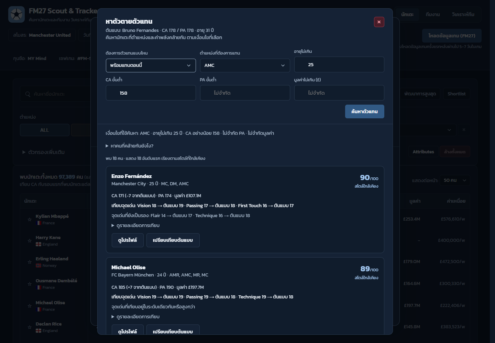
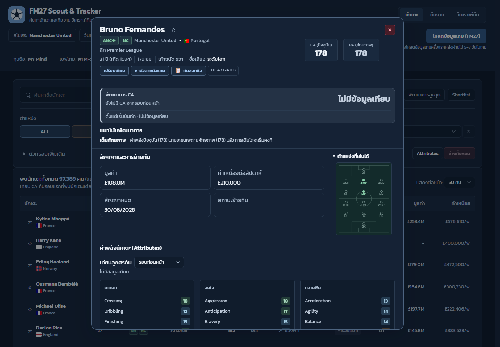
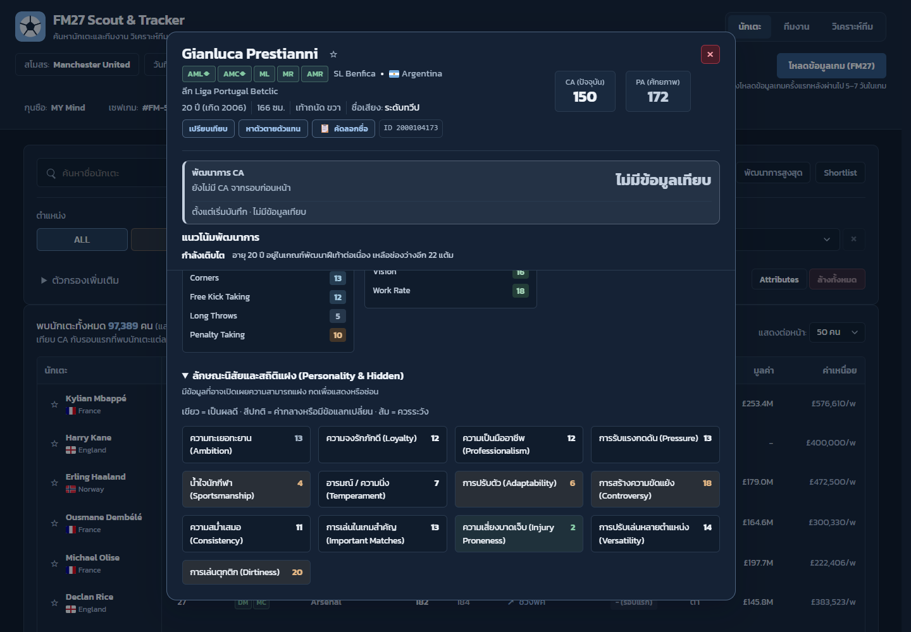
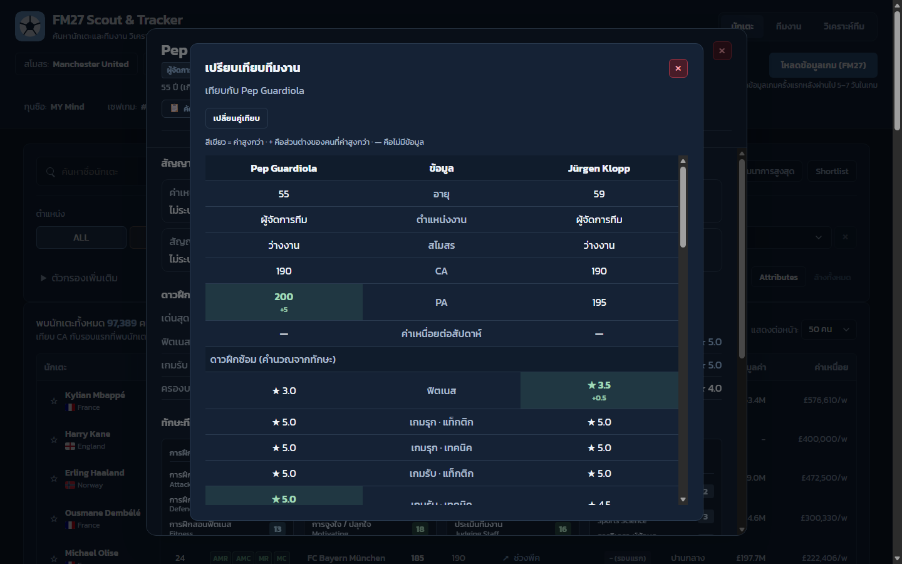
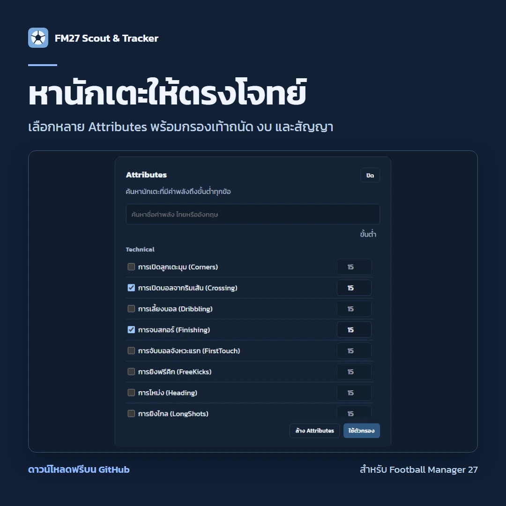
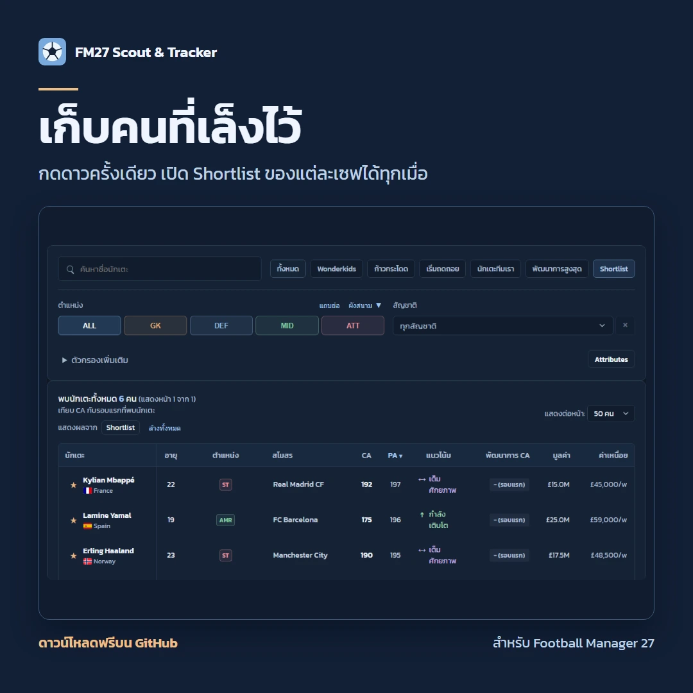
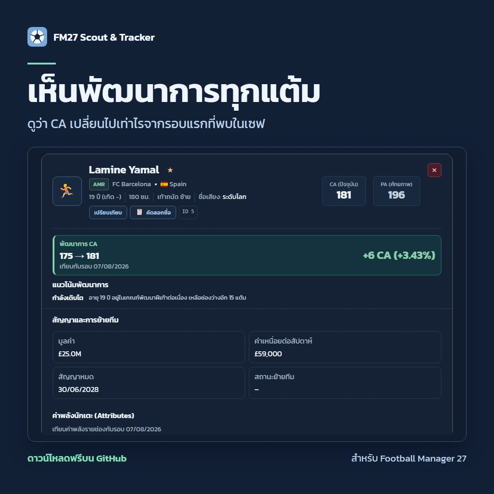
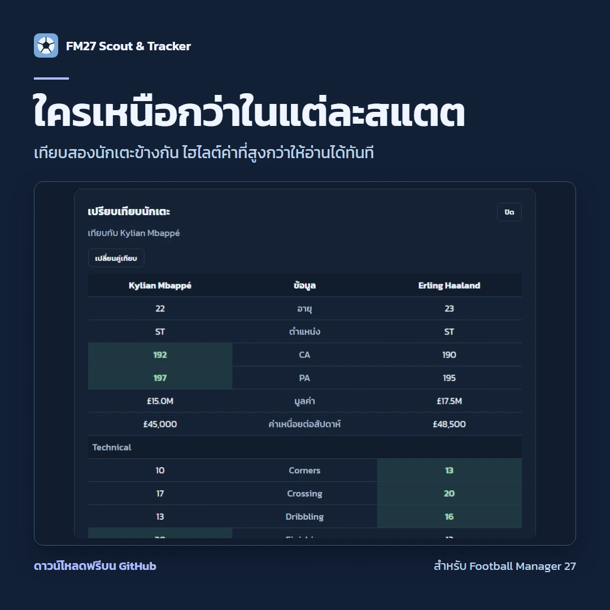
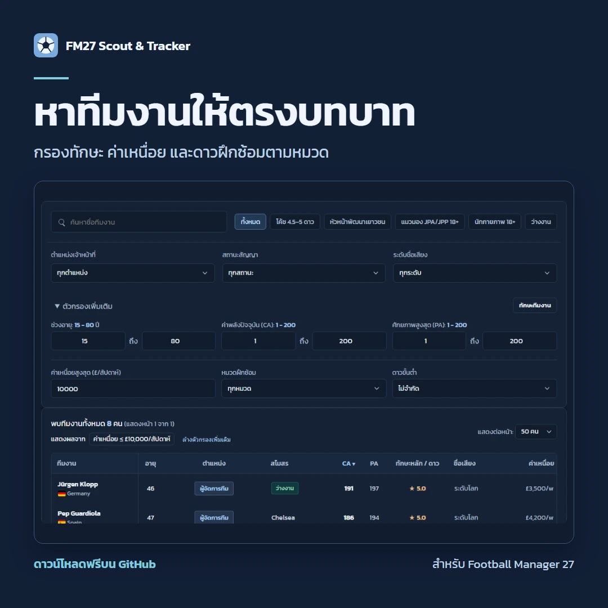
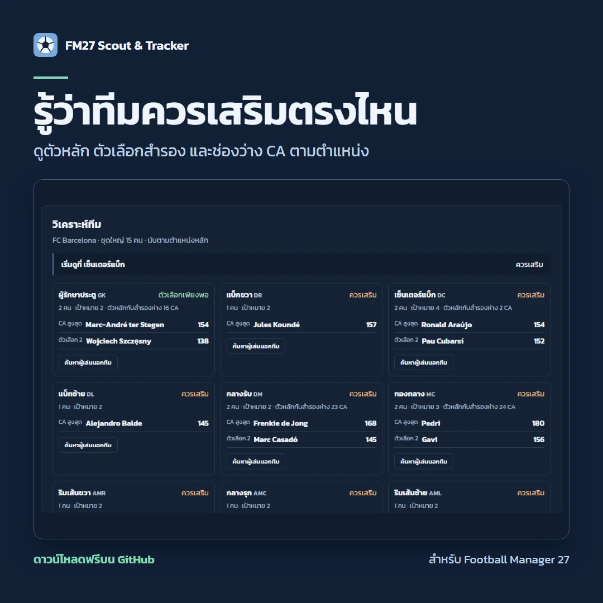

# ⚽ FM27 Scout & Tracker

> **ค้นหานักเตะและทีมงาน วิเคราะห์ทีม และติดตามพัฒนาการใน Football Manager 27**
>
> อินเทอร์เฟซภาษาไทย พร้อมระบบประมวลผลและเก็บประวัติบนเครื่องผู้ใช้

---

## ดูฟีเจอร์จากหน้าจอจริง

### ใหม่ใน v1.0.41 — ชุดค้นหา บทบาท และผังวิเคราะห์ทีม

หน้าค้นหานักเตะบันทึกตัวกรองเป็นชุดเพื่อใช้ซ้ำได้ทุกเซฟ เลือกตำแหน่งบนผังสนามแล้วเลือกบทบาทเพื่อจัดอันดับตามค่าพลัง ส่วน **วิเคราะห์ทีม → ภาพรวม** มีผังสนาม 2D ที่เน้นตำแหน่งควรเสริมเป็นสีส้ม

ดู [รายละเอียดอัปเดต v1.0.41](docs/releases/v1.0.41.md)

### ใหม่ใน v1.0.40 — วางแผนสัญญาและนักเตะปล่อยยืม

หน้า **วิเคราะห์ทีม** มีมุมมองภาพรวม สัญญา ปล่อยยืม และดาวรุ่ง ดูผลเมื่อไม่ต่อสัญญาในอีก 6 หรือ 12 เดือน และเทียบนักเตะปล่อยยืมกับตัวเลือกชุดใหญ่ได้ ส่วนหน้าทีมงานเพิ่มตัวเลือก **รวมคนที่สนใจทำตำแหน่งนี้** ใต้ช่องเลือกตำแหน่ง

ดู [รายละเอียดอัปเดต v1.0.40](docs/releases/v1.0.40.md)

### ใหม่ใน v1.0.39 — ตัวกรองค่าพลังแฝงและลีก

เปิด **Attributes → ลักษณะนิสัยและค่าพลังแฝง** เพื่อกรองหลายค่าพร้อมกัน เช่น เล่นในเกมสำคัญ 15 ขึ้นไป และเสี่ยงบาดเจ็บไม่เกิน 8 ที่ **ตัวกรองเพิ่มเติม → ลีก / ดิวิชัน** ค้นชื่อและเลือกได้สูงสุด 12 ลีก หรือใช้ลีกเดียวกับทีมชุดใหญ่ที่คุม หากว่างงานให้เลือกลีกเอง

ดู [รายละเอียดอัปเดต v1.0.39](docs/releases/v1.0.39.md)

### ใหม่ใน v1.0.38 — แก้โค้ชลูกตั้งเตะที่มีสังกัด

แก้บทบาทโค้ชลูกตั้งเตะที่ตัวสแกนเคยระบุเป็นนักวิเคราะห์ผลงาน เช่น **Nicolas Jover ของ Arsenal** และ **Matt Neil ของ MK Dons** ตัวกรองโค้ชลูกตั้งเตะจึงแสดงทั้งคนมีสังกัดและคนว่างงาน โดยรายชื่อ โปรไฟล์ และช่องค้นหาคู่เปรียบเทียบใช้บทบาทตรงกัน นักวิเคราะห์จริงยังอยู่ในหมวดเดิม ใช้ข้อมูลสแกนเดิมที่มีรหัสงานได้ ไม่ต้องลบประวัติหรือเริ่มบันทึกใหม่

ดู [รายละเอียดอัปเดต v1.0.38](docs/releases/v1.0.38.md)

### ใหม่ใน v1.0.37 — คืนทีมงานว่างงานและยกเลิกตรึงหัวตาราง

แก้ทีมงานว่างงานที่เคยถูกซ่อนเมื่อข้อมูลตำแหน่งยังอ่านไม่ครบ เช่น **Jonny Evans (ID 5005078)** ซึ่งเป็นโค้ชลูกตั้งเตะ เพิ่มการอ่านตำแหน่งที่ต้องการของโค้ชลูกตั้งเตะและนักกายภาพบำบัด คนว่างงานที่ยังระบุบทบาทไม่ได้ยังค้นหาได้ โดยไม่สร้างดาวโค้ชขึ้นมา ส่วนฝ่ายบริหารสโมสรยังแยกออกจากรายชื่อเหมือนเดิม

เอาการตรึงหัวคอลัมน์นักเตะและทีมงานที่เพิ่มใน v1.0.36 ออกแล้ว หัวตารางกลับไปเลื่อนตามหน้า ไม่มีการเปลี่ยน Scanner Binary หรือลบประวัติเดิม

ดู [รายละเอียดอัปเดต v1.0.37](docs/releases/v1.0.37.md)

### ใหม่ใน v1.0.36 — ตรึงหัวตารางและแก้บทบาททีมงาน

หัวคอลัมน์ตาราง **นักเตะและทีมงาน** ตามอยู่ใต้ส่วนหัวแอประหว่างเลื่อนหน้า ใช้หัวตารางเดิมจึงยังกดเรียงข้อมูลและเลื่อนแนวนอนได้เหมือนเดิม

รายชื่อทีมงานเอาฝ่ายบริหารสโมสรและรายการ **Staff Member ที่ยังระบุบทบาทไม่ได้** ออกจากผลค้นหา รวมถึงช่องคู่เปรียบเทียบ แก้ fallback ที่เคยจัดกลุ่มนี้เป็นโค้ช ดาวฝึกสอนและตัวกรองดาวใช้เฉพาะกลุ่มฝึกสอน การคัดออกจากรายชื่อไม่ลบข้อมูลสแกนหรือประวัติเดิม

ดู [รายละเอียดอัปเดต v1.0.36](docs/releases/v1.0.36.md)

### ใหม่ใน v1.0.35 — หาตัวตายตัวแทน

เปิดโปรไฟล์นักเตะแล้วกด **หาตัวตายตัวแทน** เลือกตำแหน่งและโหมด **พร้อมแทนตอนนี้** หรือ **ปั้นไว้แทน** กรองอายุ มูลค่า และ CA/PA ได้ ระบบคัดคนตามเงื่อนไขก่อน แล้วเรียงจากรูปแบบ Attributes ที่คล้ายกัน แสดง 20 อันดับพร้อมจุดเด่นที่เทียบ จุดที่ยังเป็นรอง และปุ่มเปิดโปรไฟล์หรือเปรียบเทียบต้นแบบ

- **พร้อมแทนตอนนี้:** ค่าเริ่มต้น CA ≥ CA ปัจจุบันต้นแบบ −20
- **ปั้นไว้แทน:** ค่าเริ่มต้น PA ≥ CA ปัจจุบันต้นแบบ −10 ไม่ตั้ง CA ขั้นต่ำ
- ทั้งสองโหมดไม่มีเพดานบน ปรับขั้นต่ำเองได้ และใช้ข้อมูลรอบสแกนล่าสุดเดียวกัน คะแนนสไตล์ไม่ใช่ระดับฝีเท้าหรือโอกาสสำเร็จ PA ไม่รับประกันว่าจะพัฒนาไปถึง และสถิติแฝงไม่รวมในคะแนน



โปรไฟล์เพิ่ม **ผังตำแหน่งที่เล่นได้** ขนาดเล็กข้างข้อมูลสัญญา ใช้สีเขียวทุกตำแหน่งที่มีข้อมูล เป็นผังดูอย่างเดียวและพับไว้บนจอแคบ ส่วน **ลักษณะนิสัยและสถิติแฝง** พับไว้ทุกครั้งที่เปิดโปรไฟล์ทั้งนักเตะและทีมงาน กดเปิดเองได้ สีเขียวหมายถึงเป็นผลดี สีส้มหมายถึงควรระวัง โดยค่าความเสี่ยงใช้ทิศทางกลับกัน ส่วน Ambition ใช้สีกลางและมีคำอธิบายข้อแลกเปลี่ยน




ค้น **sesko** เจอ **Šeško** หรือ **jurgen** เจอ **Jürgen** ได้ในหน้ารายชื่อและช่องคู่เปรียบเทียบทั้งนักเตะและทีมงาน ชื่อที่แสดงยังสะกดตามเกม ปุ่ม **ล้างทั้งหมด** เป็นสีแดงให้เห็นชัดขึ้น ส่วนหน้าหาตัวแทนตรึงหัวข้อและตัวกรองไว้ และเปิดดูตัวแทนแล้วกลับรายชื่อเดิมได้โดยไม่เสียต้นแบบ

ดู [รายละเอียดอัปเดต v1.0.35](docs/releases/v1.0.35.md)

### ใหม่ใน v1.0.34 — เปรียบเทียบทีมงาน

เปิดโปรไฟล์ทีมงานแล้วกด **เปรียบเทียบ** ค้นหาคู่เทียบ หรือเลือก **เฉพาะทีมงานในสโมสรเรา** เพื่อเทียบ CA/PA ทักษะแต่ละหมวด และดาวฝึกซ้อมเมื่อทั้งคู่เป็นทีมงานสายฝึกสอน ช่องสีเขียวหมายถึงค่าที่สูงกว่า พร้อมตัวเลขส่วนต่าง ค่าที่ไม่มีข้อมูลแสดงขีด และคู่เทียบต้องมาจากเซฟกับรอบสแกนเดียวกัน



ปรับปุ่มปิดหน้าต่าง Attributes, ทักษะทีมงาน, เปรียบเทียบ และรายการอัปเดตเป็นกากบาทรูปแบบเดียวกัน เพิ่มลิงก์เว็บไซต์ที่ท้ายโปรแกรม และเปลี่ยนข้อความฐานเปรียบเทียบเป็น **กำลังโหลด...** หรือ **ยังไม่มีประวัติเปรียบเทียบ** ตามสถานะ การเปลี่ยนข้อความนี้ไม่ลบประวัติเดิม

### ใหม่ใน v1.0.33 — แจ้งปัญหาและข้อเสนอแนะ

กด **แจ้งปัญหา / ข้อเสนอแนะ** ข้างปุ่มเช็กอัปเดต เลือกประเภท กรอกหัวข้อและรายละเอียด แล้วกดส่งถึงผู้พัฒนาทาง Discord ได้จากแอป ช่องทางติดต่อกลับไม่บังคับ ระบบแนบเวอร์ชันและคอมมิตเพื่อช่วยตรวจสอบปัญหา โดยไม่แนบข้อมูลเกมหรือประวัติให้อัตโนมัติ ต้องเชื่อมต่ออินเทอร์เน็ต และเว้นอย่างน้อย 30 วินาทีระหว่างข้อความ ดูรายละเอียดใน [PRIVACY.md](PRIVACY.md)

API ส่งต่อทำงานบน Cloudflare ของโครงการ ส่วน webhook เก็บเป็น Secret ฝั่งเซิร์ฟเวอร์ จึงไม่ต้องตั้งค่า Discord บนเครื่องผู้ใช้ Dropdown และปุ่มปิดในฟอร์มใช้รูปแบบเดียวกับหน้านักเตะและทีมงาน

<table>
<tr>
<td width="50%" valign="top"><br><strong>ค้นหานักเตะ</strong><br>ติ๊ก Attributes ได้หลายข้อ แล้วกรองร่วมกับเท้าถนัด งบ ค่าเหนื่อย สถานะย้ายทีม หรือสัญญาใกล้หมด</td>
<td width="50%" valign="top"><br><strong>Shortlist แยกตามเซฟ</strong><br>กดดาวเก็บนักเตะที่สนใจ แล้วเปิดดูรายชื่อของเซฟนั้นได้ทันที</td>
</tr>
<tr>
<td width="50%" valign="top"><br><strong>ติดตามพัฒนาการ CA</strong><br>ดูส่วนต่าง CA จากรอบแรกที่พบ พร้อมส่วนสูง เท้าถนัด ชื่อเสียง และสัญญาในโปรไฟล์</td>
<td width="50%" valign="top"><br><strong>เปรียบเทียบนักเตะ</strong><br>เลือกคู่เทียบจากโปรไฟล์ แล้วดูค่าพลังข้างกันพร้อมไฮไลต์ค่าที่สูงกว่า</td>
</tr>
<tr>
<td width="50%" valign="top"><br><strong>ทีมงาน</strong><br>ค้นหาโค้ช แมวมอง และทีมแพทย์ด้วยค่าทักษะ เพดานค่าเหนื่อย และดาวฝึกซ้อมรายหมวด</td>
<td width="50%" valign="top"><br><strong>วิเคราะห์ทีม</strong><br>ดูความพร้อมใน 10 กลุ่มตำแหน่งจากจำนวนผู้เล่นและช่องว่าง CA แล้วกดค้นหาผู้เล่นนอกทีมได้เลย</td>
</tr>
</table>

ภาพจากหน้าจอ Tracker โดยใช้ข้อมูลตัวอย่าง

## 🌟 ฟีเจอร์หลัก (Key Features)

### 1. 📈 ระบบติดตามพัฒนาการนักเตะ (Player Progression Tracking)
* **พัฒนาการ CA** ในโปรไฟล์แสดงผลต่างจากรอบก่อนหน้าและรอบแรกที่บันทึก CA ของนักเตะในเซฟเดียวกัน พร้อมวันที่ของแต่ละรอบ ตารางนักเตะยังใช้ฐานเปรียบเทียบที่เลือกไว้ โดยค่าเริ่มต้นคือรอบแรกที่พบ
* **เปรียบเทียบค่าพลังรายช่อง** เลือกเทียบกับ **รอบก่อนหน้า** (ค่าเริ่มต้น) หรือ **รอบแรกที่มีข้อมูล** ลูกศร **↑**, **↓**, **→** จะแสดงเมื่อมีค่าทั้งสองรอบ หากรอบที่เลือกไม่มีข้อมูลสแตต จะขึ้น **ไม่มีข้อมูลเทียบ** สแกนซ้ำวันเดิมจะอัปเดตรอบเดิม
* **Shortlist** กดดาวข้างชื่อนักเตะหรือในโปรไฟล์ รายการเก็บในเครื่องและแยกตามเซฟ
* **การเรียงตาราง** เริ่มจาก CA สูงสุด ส่วน Wonderkids เริ่มจาก PA สูงสุด
* **ตัวกรองเพิ่มเติม** เลือกเท้าถนัด มูลค่าสูงสุด ค่าเหนื่อย สถานะย้ายทีม และสัญญาหมดภายใน 6 หรือ 12 เดือน ส่วน **Attributes** เลือกค่าขั้นต่ำได้หลายข้อพร้อมกัน และค้นชื่อสแตตได้ทั้งไทยและอังกฤษ
* **สนใจย้ายทีม** ประเมินระดับสูง ปานกลาง หรือต่ำจากส่วนต่างชื่อเสียงของทีมเราและสโมสรปัจจุบันของนักเตะ กรณีไร้สังกัดใช้ชื่อเสียงนักเตะ กดหัวคอลัมน์เพื่อเรียงได้ ผลจริงขึ้นอยู่กับการเจรจาในเกม
* **รายละเอียดนักเตะ** แสดงส่วนสูง เท้าถนัด ระดับชื่อเสียง และข้อมูลสัญญา จัดหมวดค่าพลังตามหน้าจอในเกมสำหรับผู้รักษาประตูและผู้เล่นเอาต์ฟิลด์
* **ค้นหาและกรองนักเตะ** ค้นตามชื่อ กรองตามอายุ ตำแหน่ง สัญชาติ และช่วง CA/PA หรือใช้ปุ่มลัด Wonderkids, ก้าวกระโดด, เริ่มถดถอย, นักเตะทีมเรา และพัฒนาการสูงสุด ตัวกรองสัญชาติใช้รายการจากเซฟที่สแกนและค้นได้จากทุกสัญชาติที่บันทึกไว้ของนักเตะแต่ละคน
* **โปรไฟล์นักเตะ** แสดง ID จากตัวสแกน ค่าพลัง และสรุปพัฒนาการ CA ส่วนชื่อ, CA/PA และแนวโน้มจะตรึงอยู่ด้านบนขณะเลื่อนดูค่าพลังและสถิติแฝง
  * แสดงลีกหรือดิวิชันและสโมสรต้นสังกัดเมื่อมีข้อมูล พร้อมเครื่องหมาย **◆** บนตำแหน่งถนัดโดยธรรมชาติที่ตัวสแกนระบุ
  * **สถิติแฝงด้านการเล่น** แสดงความสม่ำเสมอ การเล่นในเกมสำคัญ ความเสี่ยงบาดเจ็บ การปรับเล่นหลายตำแหน่ง และการเล่นตุกติก
* **เปรียบเทียบนักเตะสองคน** กด **เปรียบเทียบ** ในโปรไฟล์แล้วค้นชื่อคู่เทียบ ระบบแสดงค่าพลังจากรอบสแกนเดียวกันและไฮไลต์ค่าที่สูงกว่าในแต่ละแถว
* **คำแปลค่าพลัง** ชี้เมาส์ที่ชื่อสแตตภาษาอังกฤษในโปรไฟล์หรือในตารางเปรียบเทียบเพื่อดูคำแปลภาษาไทย
* **ธงสัญชาติหลัก** ตารางและโปรไฟล์แสดงธงคู่กับชื่อสัญชาติแรกที่ Scanner ส่งมา ตัวกรองสัญชาติยังค้นได้จากทุกสัญชาติที่บันทึกไว้ ธงโหลดจากไฟล์ในแอปและใช้แบบออฟไลน์ได้
* **นักเตะที่เพิ่งพบ** แสดงป้าย **พบครั้งแรก** หรือ **เกิดใหม่** เมื่อข้อมูลสแกนระบุว่าเป็น newgen
* **พยากรณ์แนวโน้มการเติบโต (Trend Forecasting)** ใช้อายุ นิสัยแฝง ช่องว่าง CA/PA และผลต่าง CA จากรอบก่อนหน้าของเซฟเดียวกัน ทั้งตาราง โปรไฟล์ และตัวกรองใช้เกณฑ์เดียวกัน
  * **↑↑ ก้าวกระโดด** (เขียว) — มีโอกาสพัฒนาได้มาก
  * **↑ กำลังเติบโต** (เขียวอ่อน) — ยังมีโอกาสพัฒนาก่อนถึงจุดพีค
  * **↗ ช่วงพีค** (ฟ้าอ่อน) — อยู่ในวัยพีคและ CA ใกล้ PA
  * **↔ เต็มศักยภาพ** (ม่วงอ่อน) — CA ใกล้เพดานศักยภาพ
  * **→ คงที่** (เทา) — ระบบประเมินว่าอยู่ในช่วงรักษาระดับ
  * **↓ เริ่มถดถอย** (แดงอ่อน) — ระบบประเมินว่าอยู่ในช่วงถดถอย
  * คอลัมน์ **แนวโน้ม** แสดงผลประเมิน ส่วน **CA เทียบรอบแรก** แสดงผลต่างจากรอบแรกที่พบนักเตะแต่ละคนในเซฟนี้ หากใช้รอบอ้างอิงอื่น หัวคอลัมน์จะแสดง **CA เทียบรอบที่เลือก**
* **ผังสนามเลือกตำแหน่ง (Tactical Pitch Selector)** เลือกจากผังสนามหรือแถบย่อ พร้อมตัวเลือก **Natural Position Only** ป้ายตำแหน่งใช้สีส้มสำหรับ GK น้ำเงินสำหรับ DEF เขียวสำหรับ MID และแดงสำหรับ ATT

---

### 2. 👔 ทีมงาน (Staff Scout)
* **ตัวกรองทีมงาน** เลือกทักษะขั้นต่ำได้หลายข้อ พร้อมเพดานค่าเหนื่อยและดาวฝึกซ้อมขั้นต่ำรายหมวด โปรไฟล์แสดงวันหมดสัญญาเมื่อมีข้อมูลและจัดลำดับทักษะตามสายงาน
  * กด **ล้างทั้งหมด** ข้างปุ่ม **ทักษะทีมงาน** เพื่อล้างคำค้นและตัวกรอง กลับไปหน้าแรกและเรียง CA จากมากไปน้อย
* **ค้นหาทีมงานจากเซฟที่เปิดอยู่** ครอบคลุมโค้ช แมวมอง นักวิเคราะห์ ทีมแพทย์ และฝ่ายบริหาร จำนวนขึ้นอยู่กับผลสแกนของแต่ละเซฟ
* **ปุ่มลัดคัดกรองระดับโลก (Elite Preset Shortcuts)**:
  * 👁️ **แมวมองตาเพชร (JPA/JPP 18+)**: คัดเฉพาะแมวมองที่มีทักษะตัดสินใจศักยภาพและฝีเท้า 18 ขึ้นไป
  * 🏥 **หมอเทวดา (Physiotherapy 18+)**: คัดทีมนักกายภาพบำบัดรักษาอาการบาดเจ็บระดับท็อป
  * ⭐ **โค้ช 4.5–5 ดาว**: คัดเฉพาะโค้ชฝึกซ้อมที่มีคะแนนดาวฝึกซ้อมตั้งแต่ 4.5 ดาวขึ้นไป
  * 🌟 **HOYD ปั้นเยาวชน**: กรองหัวหน้าฝ่ายพัฒนาเยาวชน
  * 🆓 **สตาฟฟ์ว่างงาน (Unemployed)**: กรองทีมงานตามสถานะว่างงาน
* **คำนวณดาวฝึกซ้อม 6 หมวดตามสูตร FM**: เกมรุก, เกมรับ, แท็กติก, เทคนิค, ผู้รักษาประตู, ฟิตเนส
* **ปุ่มคัดลอกชื่อ (Copy Name)**: คลิกเดียวคัดลอกชื่อนักเตะหรือสตาฟฟ์ไปวางค้นหาใน FM27 ได้ทันที

---

### 3. วิเคราะห์ทีม (Squad Analysis)

* ดูความพร้อมตามตำแหน่งหลักของทีมชุดปัจจุบัน พร้อมคำแนะนำจากจำนวนผู้เล่นและส่วนต่าง CA ของสองอันดับแรก
* กด **ค้นหาผู้เล่นนอกทีม** จากตำแหน่งที่สนใจ แล้วใช้ตัวกรองของหน้านักเตะต่อได้
* **ดาวรุ่งที่มีพรสวรรค์** คัดนักเตะนอกชุดใหญ่อายุไม่เกิน 21 ปี เทียบ CA กับผู้เล่น CA อันดับ 2 และเทียบ PA กับ CA ของผู้เล่นอันดับ 1 ในกลุ่มตำแหน่งเดียวกัน พร้อมแสดงชื่อผู้เล่นที่ใช้เทียบ
* กดชื่อนักเตะเพื่อเปิดโปรไฟล์ได้ทั้งจากการ์ดชุดใหญ่และตารางดาวรุ่ง

### 4. 🎯 ระบบตรวจจับเซฟเกมและ RefCode
* **ตรวจจับเซฟจากผลสแกน** เมื่อสลับเซฟใน FM27 ให้กด **โหลดข้อมูลเกม (FM27)** อีกครั้ง Tracker ใช้ข้อมูลที่อ่านได้เพื่อระบุเซฟ บางกรณี เช่น เซฟว่างงานที่ระบุกุนซือไม่ได้ อาจยังจับคู่ประวัติไม่ได้
* **Save RefCode** หน้าจอแสดงรหัสแบบ **`#FM-55649B`** โดยใช้รหัสเดิมภายในสำหรับจับคู่ประวัติ เมื่อย้ายทีมแล้วระบบยังระบุอาชีพเดิมได้ ก็ใช้รหัสและประวัติเดิมต่อ
* **ประวัติแยกตามอาชีพ** ระบบใช้ Manager ID และข้อมูลเซฟที่อ่านได้เพื่อจับคู่ snapshot กับอาชีพของผู้เล่น

---

### 5. 👑 ดีไซน์เพื่อกุนซือ (Manager Header UI)
* แสดงสโมสร ผู้จัดการ รหัสเซฟ วันที่ในเกมแบบวัน/เดือน/ปี ค.ศ. และฐานเปรียบเทียบพัฒนาการ
* **วันที่อาจคลาดเคลื่อนจากวันในเกม แต่ข้อมูลนักเตะอ้างอิงจากรอบสแกนล่าสุด** กด **โหลดข้อมูลเกม (FM27)** อีกครั้งเพื่อดูการเปลี่ยนแปลงหลังรอบนั้น
* **เซฟใหม่** ลองโหลดข้อมูลเกมครั้งแรกหลังผ่านไป 5–7 วันในเกม
* **เช็กอัปเดตในแอป** รุ่น Setup และ ZIP ตรวจเมื่อเปิดแอปและทุก 10 นาทีระหว่างเปิดค้างไว้ หรือกด **เช็กอัปเดต** ได้ทันที เมื่อพบรุ่นใหม่ให้กด **อัปเดตและเปิดใหม่** Tracker จะดาวน์โหลดและตรวจ SHA-256 ให้เอง รุ่น Setup ตั้งแต่ v1.0.9 ใช้ไฟล์ Setup และขอสิทธิ์ผ่าน Windows ก่อนติดตั้ง ส่วนรุ่นพกพาใช้ ZIP

---

## 🚀 วิธีติดตั้งและเปิดใช้งาน (Getting Started)

### ความต้องการของระบบ:
* ระบบปฏิบัติการ **Windows 10 หรือ Windows 11 (64-bit)**
* ตัวเกม **Football Manager 2027 (FM27)**
* **Windows Setup และ Portable ZIP ตั้งแต่ v1.0.14** มี Node.js และ FMSuperScout Scanner มาให้แล้ว ใช้ Node.js ในแพ็กเกจแม้เครื่องมี Node.js ติดตั้งอยู่
* การรันจากซอร์สด้วย `npm start` ใช้ Node.js ที่ติดตั้งในเครื่อง

### ดาวน์โหลดและติดตั้ง

ดาวน์โหลดจาก [GitHub Releases](https://github.com/kamonsak95-alt/FM27-Thai-Progression-Tracker/releases/latest) แล้วเลือกไฟล์ตามวิธีที่ต้องการ

| รุ่น | วิธีเปิด | ที่เก็บประวัติ |
| --- | --- | --- |
| **Windows Setup (v1.0.9 ขึ้นไป)** | เปิด `FM27-Tracker-Setup-v…exe` ค่าเริ่มต้นคือ `C:\Program Files\FM27 Tracker` จากนั้นเปิด **FM27 Tracker** จาก Start Menu | `%LOCALAPPDATA%\FM27 Tracker\data\history.json` |
| **Windows ZIP (Portable)** | แตก ZIP ทั้งหมด แล้วดับเบิลคลิก `FM27-Tracker\bin\FM27-Tracker.exe` | `data\history.json` ในโฟลเดอร์ที่แตก ZIP |

**วิธีเปิด Portable ZIP ตั้งแต่ v1.0.14**

1. ดาวน์โหลดไฟล์ `FM27-Tracker-Windows-v<เวอร์ชัน>.zip` จากหน้า Releases
2. คลิกขวาที่ไฟล์ ZIP แล้วเลือก **Extract All… (แตกไฟล์ทั้งหมด)**
3. เข้าโฟลเดอร์ `FM27-Tracker` → `bin` แล้วดับเบิลคลิก **`FM27-Tracker.exe`** ทุกครั้งที่ต้องการเปิดแอป

Setup ใช้สิทธิ์แอดมินและยังไม่ได้เซ็นดิจิทัล ไฟล์ SHA-256 อยู่ในหน้า Release ถ้าพอร์ต `3000` ใช้ไม่ได้ Tracker จะเลือกพอร์ตสำรองและจำพอร์ตที่ใช้ได้สำหรับการเปิดครั้งถัดไป

สำหรับผู้จัดทำ Release ให้สร้าง ZIP ด้วย `installer/Build-Portable.ps1 -OutputFolder <folder>` แล้วส่ง ZIP ที่ได้ให้ `installer/Build-Installer.ps1` ผ่าน `-ReleaseZip` สคริปต์ ZIP ตรวจ SHA-256 ของ Node.js Windows x64 ก่อนนำไปบรรจุ ส่วนการรันจากซอร์สด้วย `npm start` ใช้ Node.js ของเครื่องพัฒนา

### เริ่มใช้งาน

1. เปิดเกม **FM27** และโหลดเซฟเกมของคุณให้เรียบร้อย
2. เปิด Tracker แล้วกด **โหลดข้อมูลเกม (FM27)** บนแถบด้านบน
3. เมื่อสแกนเสร็จ ค้นหานักเตะหรือทีมงานจากตาราง หรือกดดาวข้างชื่อนักเตะเพื่อเพิ่มเข้า Shortlist

### ย้ายประวัติจากรุ่นเดิม

ถ้าย้ายจาก Setup v1.0.8 ให้ปิด Tracker และเซิร์ฟเวอร์เดิม แล้วคัดลอก `history.json` จาก `%LOCALAPPDATA%\Programs\FM27 Tracker\data` ไปยัง `%LOCALAPPDATA%\FM27 Tracker\data` ถ้ามาจาก ZIP ให้ใช้ไฟล์ในโฟลเดอร์ `data` ของรุ่นนั้น สำรองไฟล์ปลายทางก่อนหากมีประวัติอยู่แล้ว เพราะการวางทับจะแทนที่ข้อมูลเดิม ตั้งแต่ v1.0.14 ให้สำรอง `shortlist.json` ข้าง `history.json` ด้วย รุ่นนี้ย้าย Shortlist จากเบราว์เซอร์ให้อัตโนมัติเมื่อเปิดผ่านที่อยู่และโปรไฟล์เดิมและเซฟยังไม่มีรายการในไฟล์ หากเปลี่ยนไปใช้พอร์ตสำรอง รายการจากพอร์ตเดิมจะยังไม่แสดง

---

## 🔒 นโยบายความเป็นส่วนตัวและความปลอดภัย (Privacy Notice)

Scanner อ่านข้อมูลเกมแบบอ่านอย่างเดียว Tracker เก็บผลสแกนและประวัติบนเครื่อง การเช็กอัปเดตติดต่อ GitHub ผ่าน Releases API หรือ Git ตามวิธีติดตั้ง และหน้าแอปโหลดฟอนต์จาก Google Fonts เมื่อออนไลน์ รายละเอียดไฟล์ข้อมูลและการแชร์อยู่ใน [Privacy Notice](PRIVACY.md)

---

## 🛠️ โครงสร้างโปรเจกต์ (Project Structure)

```text
FM27-Tracker/
├── bin/                     # เครื่องยนต์สแกน Memory แบบ Standalone (FMSuperScout.Scanner.exe)
├── data/                    # ประวัติและ Shortlist ของรุ่น Portable (history.json, shortlist.json)
├── public/                  # หน้าบ้านเว็บแอป (HTML5, CSS3, Vanilla JS)
│   ├── index.html           # โครงสร้างหน้าเว็บหลักและ Modal ต่างๆ
│   ├── style.css            # ธีมและการจัดวางหน้าแอป
│   └── app.js               # Logic จัดการ UI, ตัวกรอง, การคำนวณหน้าบ้าน
├── server/                  # ระบบหลังบ้าน Node.js (Local HTTP Server)
│   ├── index.js             # API Router และจุดเริ่มต้นของเซิร์ฟเวอร์
│   ├── historyEngine.js     # ระบบบันทึก Snapshot, First Seen Baseline, Save Isolation
│   ├── snapshotAttributes.js # รูปแบบจัดเก็บค่าพลังรายช่องใน Snapshot
│   ├── staffEngine.js       # ระบบกรองทีมงาน, JPA/JPP, คำนวณดาวโค้ช 6 ด้าน
│   ├── trendEngine.js       # ระบบวิเคราะห์และพยากรณ์แนวโน้มการเติบโต
│   ├── scannerBridge.js     # สะพานเชื่อมต่อกับ FMSuperScout Scanner
│   └── updaterEngine.js     # ระบบตรวจเช็กและดาวน์โหลดอัปเดตจาก GitHub
├── installer/               # ตัวเปิด Windows และสคริปต์สร้าง Setup
├── test/                    # ชุดทดสอบประวัติ, API, Scanner และ UI แบบ static
├── Start-FM27-Tracker-Window.vbs  # ตัวเปิดแอปแบบไร้หน้าต่างดำ
└── Start-FM27-Tracker.bat         # ตัวเปิดแอปผ่าน Shell Script
```

---

## การทดสอบ

รัน `npm test` จากโฟลเดอร์โปรเจกต์ ชุดทดสอบ API บางส่วนต้องมีผลสแกน FM27 ในเครื่อง

## 💖 เครดิตและคำขอบคุณ (Credits & Acknowledgements)

* ธงสัญชาติจาก [flag-icons](https://github.com/lipis/flag-icons) ภายใต้ [MIT License](public/vendor/flag-icons/LICENSE)
* ขอขอบคุณ **[@mavarobli](https://github.com/mavarobli)** ผู้พัฒนาโปรแกรม **[FMSuperScout](https://github.com/mavarobli/FMSuperScout)** สำหรับเครื่องยนต์สแกนหน่วยความจำ (C# Memory Scanner Engine) ภายใต้สัญญาอนุญาต **MIT License**
* พัฒนาและต่อยอดระบบโดยคอมมูนิตี้ผู้เล่นชาวไทย เพื่อมุ่งเน้นการติดตามพัฒนาการนักเตะระยะยาว, ระบบสเกาต์ทีมงานภาษาไทย และระบบตรวจจับเซฟเกมอัตโนมัติ

---

## 📜 สัญญาอนุญาต (License)

โปรเจกต์นี้เผยแพร่ภายใต้สัญญาอนุญาต [MIT License](LICENSE)
